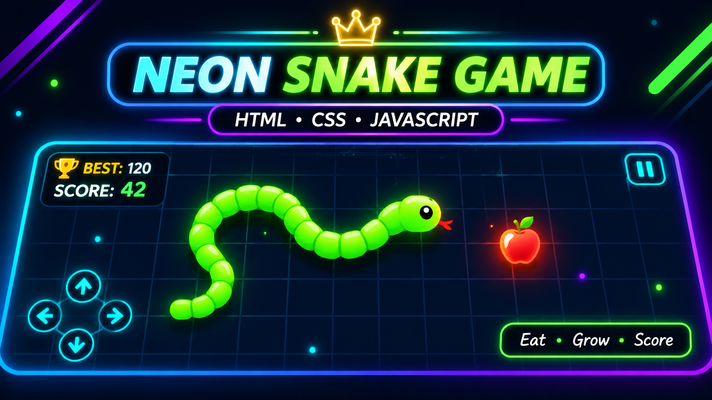
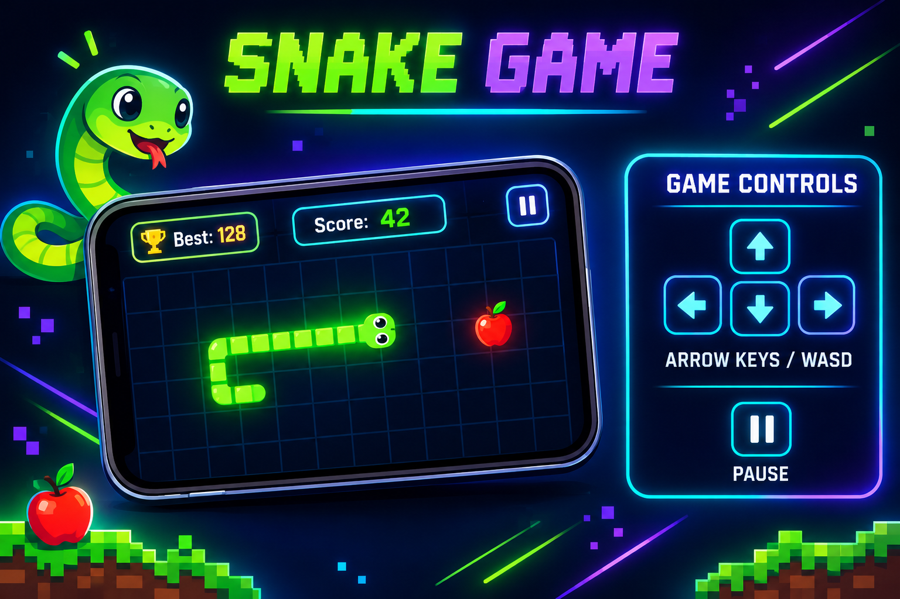

# 🐍 Neon Snake Game

<p align="center">
  A classic Snake Game with a modern neon-inspired design, built using
  <strong>HTML5, CSS3, and JavaScript</strong>.
  <br />
  Collect food, grow your snake, and challenge yourself to beat your highest score!
</p>

<p align="center">
  
  
  
</p>

<p align="center">
  
  
</p>

---

## 🖼️ Project Preview

<p align="center">
  
</p>

<p align="center">
  <em>A classic arcade experience with a fresh neon look.</em>
</p>

## 🎮 Game Controls

<p align="center">
  
</p>

---

## 📌 About the Project

Neon Snake Game is a browser-based version of the classic Snake game.

Control the snake, collect food, increase your score, and avoid hitting the walls or your own body.

I built this project to practise JavaScript fundamentals, event handling, game logic, collision detection, and interactive web development.

## ✨ Features

- 🎨 Modern neon-inspired dark UI
- 🐍 Classic Snake gameplay
- 🎮 Keyboard controls using Arrow Keys and WASD
- 🖱️ Clickable on-screen direction buttons
- 📱 Mobile-friendly touch controls
- 📊 Real-time score tracking
- 🏆 Best score tracking
- ⚡ Increasing game speed
- ⏸️ Pause and resume functionality
- 🔄 Restart game option
- 💥 Wall and self-collision detection
- 📐 Responsive game layout

## 🛠️ Technology Stack

| Technology | Purpose |
|---|---|
| HTML5 | Game structure and layout |
| CSS3 | Styling, animations and visual design |
| JavaScript | Game logic and interactions |

## 🎯 How to Play

1. Open the game in your browser.
2. Click the **Start Game** button.
3. Control the snake using Arrow Keys, WASD, or on-screen buttons.
4. Collect food to increase your score.
5. The snake grows longer whenever it collects food.
6. Avoid hitting the walls or your own body.
7. Try to achieve your highest score!

## ⌨️ Game Controls

| Key / Input | Action |
|---|---|
| ⬆️ Arrow Up / W | Move Up |
| ⬇️ Arrow Down / S | Move Down |
| ⬅️ Arrow Left / A | Move Left |
| ➡️ Arrow Right / D | Move Right |
| Spacebar | Pause / Resume |
| On-screen Arrows | Change Direction |

> 💡 **Tip:** The snake cannot immediately reverse its direction. Plan your turns carefully to avoid collisions.

## 📂 Project Structure

```text
snake-game/
│
├── README.md
│
└── snake-game/
    │
    ├── index.html
    ├── style.css
    ├── script.js
    │
    └── assets/
        ├── neon-snake-banner.png
        └── snake-game-controls.png
```

## 🚀 Getting Started

Follow these steps to run the project on your local machine.

### Prerequisites

- A modern web browser
- Visual Studio Code
- Live Server extension for VS Code (recommended)

### 1. Clone the Repository

```bash
git clone https://github.com/ayushi857-dev/snake-game.git
```

### 2. Navigate to the Project Directory

```bash
cd snake-game
```

### 3. Open the Game Folder

```bash
cd snake-game
```

### 4. Open in VS Code

```bash
code .
```

### 5. Run the Game

1. Open `index.html`.
2. Right-click inside the editor.
3. Select **Open with Live Server**.
4. The game will open in your browser.

**Note:** No additional frameworks, dependencies, or package installations are required.

## 🧠 Concepts Practised

- DOM Manipulation
- JavaScript Event Listeners
- Keyboard Event Handling
- Game Loops and Timing
- Collision Detection
- Conditional Logic
- Arrays and Coordinate Systems
- Dynamic UI Updates
- Score Management
- CSS Flexbox and Responsive Design

## 🌐 Browser Compatibility

Designed for modern browsers:

- Google Chrome
- Microsoft Edge
- Mozilla Firefox
- Safari

## 🔮 Future Improvements

- 🎚️ Multiple difficulty levels
- 🎨 Customizable snake themes
- 🍎 Different food types
- 🔊 More sound effects
- 🏅 High-score leaderboard
- 🌟 Additional game modes

## 👩‍💻 Author

**Ayushi Shukla**

Aspiring AI/ML Engineer | Web Developer

- GitHub: [@ayushi857-dev](https://github.com/ayushi857-dev)
- Project Repository: [Neon Snake Game](https://github.com/ayushi857-dev/snake-game)

## 🤝 Feedback

Suggestions and feedback are welcome.

Feel free to explore the project, share your ideas, and contribute to future improvements.

---

<p align="center">
  <strong>Built with ❤️ using HTML, CSS & JavaScript.</strong>
  <br />
  Happy Coding! 🚀
</p>
